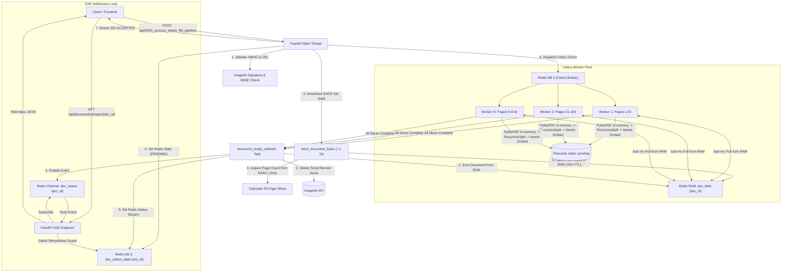
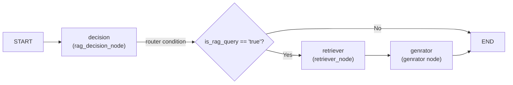

# Production RAG From Scratch — Backend Architecture & Context Guide

> **Quick Reference**: This document serves as the persistent single source of truth for the entire backend architecture, module responsibilities, agent workflows, asynchronous pipelines, and operational standards.

---

## 1. Project Overview & Core Mission

**Production RAG From Scratch** is a production-grade, multi-tenant Retrieval-Augmented Generation (RAG) backend engineered with Python, FastAPI, LangGraph, Celery, Redis, Pinecone, and Supabase.

### Core Capabilities
1. **Distributed Asynchronous Document Ingestion**: Parallelized PDF/text document parsing, chunking, embedding, and vector upserting using Celery Chords across a worker fleet with zero dispatcher CPU locking.
2. **Real-Time Job Notification (SSE + Pub/Sub)**: Server-Sent Events (SSE) combined with Redis Pub/Sub and a **Rehydration Guard** to guarantee real-time delivery of processing states (`PENDING`, `READY`, `FAILED`) to the frontend without event drop race conditions.
3. **Agentic Conversational Orchestration (LangGraph)**: Multi-step `StateGraph` incorporating security/safety classification (`decision`), intelligent routing (`router`), contextual retrieval with reranking (`retriever`), and streamed synthesis (`genrator`).
4. **Deep-Thinking Retrieval**: Dual retrieval pipeline supporting standard bi-encoder similarity search alongside a "Deep Think" pipeline featuring **FlashRank** cross-encoder reranking, redundant chunk filtering (`EmbeddingsRedundantFilter`), and `LongContextReorder`.
5. **BYOK (Bring Your Own Key) & Security**: Fernet-encrypted custom user API keys (Groq, Gemini) stored in Supabase with an in-memory `TTLCache` (`llm_cache`) for low-latency streaming without repeated database queries.
6. **Observability & Rigorous Evaluation**: Integrated LangSmith tracing, Portkey Gateway routing, and comprehensive **DeepEval** evaluation suites (Faithfulness, Answer Relevancy, Hallucination, PII Leakage, Toxicity).

---

## 2. Directory Structure & File Map

```
backend/
├── app/                                    # Main FastAPI application & core business logic
│   ├── config.py                           # Central configuration & LLM client singletons
│   ├── main.py                             # FastAPI routes, lifespan, SSE, CORS, ImageKit auth
│   ├── user_config.py                      # User-specific runtime configurations
│   ├── ApiKeyConfig/                       # API key helper modules
│   ├── agents/
│   │   └── Main_agent/
│   │       ├── graph.py                    # LangGraph StateGraph definition & compilation
│   │       ├── state.py                    # AgentState TypedDict
│   │       └── nodes/
│   │           ├── decision.py             # Security & RAG requirement classifier node
│   │           ├── router.py               # Conditional branching edge logic
│   │           ├── retriever.py            # Vector retrieval & reranking node
│   │           └── genrator.py             # Final streaming generation node
│   ├── DB/
│   │   └── database.py                     # PostgreSQL AsyncConnectionPool for LangGraph state
│   ├── Ingestion/
│   │   ├── processor.py                    # Multi-format document loader dispatcher (PDF, TXT, CSV, JSON)
│   │   ├── chunker/
│   │   │   └── doc_chunker.py              # Recursive text splitting with metadata tagging
│   │   ├── pdfloder/
│   │   │   └── loader.py                   # High-speed PyMuPDF memory loader (safe_server_pdf_loader)
│   │   ├── txtloader/
│   │   │   └── loader.py                   # Text file loader with auto encoding detection
│   │   └── vectorstore/
│   │       └── pinecone_service.py         # Pinecone client, batch upserting, similarity search & FlashRank
│   └── Queue/
│       └── tasks.py                        # Standalone Celery ingestion tasks
├── DB/
│   └── database.py                         # Root PostgreSQL AsyncConnectionPool checkpointer
├── Experiment/
│   ├── celery/rag/
│   │   ├── celery_app.py                   # Celery broker & backend configuration (Redis DB 0 & 1)
│   │   ├── redis_sync.py                   # Synchronous Redis client & connection pool for workers
│   │   ├── runner.py                       # Chord dispatcher & PDF page count inspector
│   │   └── tasks.py                        # Celery chord tasks (pdf/text slice processing & callback)
│   └── Redis/pubsub/
│       ├── pub.py                          # Redis publisher test harness
│       └── subs.py                         # Redis subscriber test harness
├── evals/                                  # DeepEval automated test suite
│   ├── harness.py                          # Metric aggregation & golden dataset loader
│   ├── eval_pipeline.py                    # End-to-end RAG pipeline evaluation
│   ├── eval_retriever.py                   # Retrieval precision & hit rate evaluation
│   ├── eval_generator.py                   # Generator hallucination & faithfulness eval
│   ├── eval_leakage.py                     # Prompt leakage & PII evaluation
│   └── eval_toxicity.py                    # Response toxicity & safety evaluation
├── goldens/                                # Ground-truth datasets for DeepEval
│   ├── correctness_goldens.json
│   ├── faithfulness_dataset.json
│   ├── generate_goldens.py
│   ├── leakage_goldens.json
│   ├── retriever_goldens.json
│   ├── scope_goldens.json
│   └── toxicity_goldens.json
├── GATEWAY/
│   └── portkey.py                          # Portkey AI gateway fallback & load balancer client
├── LLMs/
│   ├── Groq.py                             # Groq LLM setup
│   ├── NomicEmbed.py                       # DeepEval custom NomicEmbeddingJudge embedding wrapper
│   └── portkey.py                          # Portkey LangChain integration
├── services/
│   └── reranker.py                         # Cross-encoder MS-MARCO reranker
├── utils/
│   ├── prompts.py                          # System prompts (CHAT_NODE_SYSTEM_PROMPT, RAG_SYSTEM_PROMPT)
│   └── utils.py                            # Fernet crypto, API key validators, text formatting, TTL cache
├── concurrency/                            # Technical architectural deep dives & design specs
│   ├── asyncio_core_components_md.md
│   ├── async_vs_blocking_deep_dive.md
│   ├── celery_guide_and_methods.md
│   ├── concurrent_future.md
│   ├── pinecone_pool_threads_explained.md
│   ├── rag_ingestion_pipeline_architecture.md
│   └── redis_pub_sub_engineering_guide.md
├── Dockerfile                              # Python 3.13-slim production container
├── requirements.txt                        # Pinned python dependencies
└── context.md                              # This single-file project context index
```

---

## 3. Core Architecture & Execution Pipelines

### A. Distributed Ingestion Pipeline (Celery Chord + Redis Pub/Sub + In-Memory Caching)



#### Detailed Ingestion Steps
1. **Endpoint**: [`/api/RAG_process_delete_file_pipeline`](file:///D:/ProductionRAGFromScratch/backend/app/main.py#L365).
2. **Signature Verification**: Validates ImageKit HMAC SHA-1 auth string (`token + expire`).
3. **Single In-Memory Download & Cache**: [`fetch_document_bytes()`](file:///D:/ProductionRAGFromScratch/backend/Experiment/celery/rag/runner.py#L26) downloads the document **exactly once** via `httpx`. The raw binary is immediately stored in Redis in-memory storage under key `doc_blob:{doc_id}` with a 10-minute auto-expiry TTL (`ex=600`).
4. **Metadata Inspection**: Page count is extracted directly from the in-memory bytes using `pymupdf.open(stream=doc_bytes)` in ~2ms without any disk writes or duplicate network calls.
5. **State Initialization**: Stores initial `PENDING` state in Redis key `doc_status_state:{doc_id}` (TTL: 3600s).
6. **Chord Dispatch**: Slices the PDF into 50-page parallel signatures [`process_pdf_slice_task.s()`](file:///D:/ProductionRAGFromScratch/backend/Experiment/celery/rag/tasks.py#L143) chained with [`document_ready_callback.s()`](file:///D:/ProductionRAGFromScratch/backend/Experiment/celery/rag/tasks.py#L208).
7. **Zero-Network Worker Slice Ingestion**:
   - Each worker fetches raw PDF bytes in sub-milliseconds from `doc_blob:{doc_id}` using a raw binary Redis connection pool ([`get_binary_redis()`](file:///D:/ProductionRAGFromScratch/backend/Experiment/celery/rag/redis_sync.py#L30)). Falls back to network download only on cache miss.
   - Extracts clean text using `pymupdf` strictly for its allocated page slice `[start_page, end_page]`.
   - Splits text into 1,000-character chunks (150 overlap) with [`RecursiveCharacterTextSplitter`](file:///D:/ProductionRAGFromScratch/backend/Experiment/celery/rag/tasks.py#L65).
   - Tags each chunk with metadata: `user_id`, `conversation_id`, `page`, `source_url`.
   - Embeds and upserts into Pinecone synchronously via [`update_vector_store_celery()`](file:///D:/ProductionRAGFromScratch/backend/app/Ingestion/vectorstore/pinecone_service.py#L276) in batches of 100.
8. **Chord Completion Callback & Dual-Layer Teardown**:
   - Evicts `doc_blob:{doc_id}` from Redis RAM immediately upon completion (or error), freeing server memory.
   - Computes total stored chunks across slices.
   - Deletes temporary raw file from ImageKit via REST API.
   - Updates `doc_status_state:{doc_id}` with `status: "READY"`.
   - Emits a JSON completion message on Redis channel `doc_status:{doc_id}`.
9. **Fair-Scheduling & Multi-Tenant Starvation Prevention**:
   - `worker_prefetch_multiplier = 1`: Workers only reserve one task at a time, preventing greedy hoarding.
   - `task_acks_late = True`: Tasks remain in Redis broker until execution succeeds, preventing unpicked tasks from blocking other users.
   - Finer slice granularity (`PAGES_PER_SLICE = 50`): Slices complete in seconds, allowing multi-user tasks to interleave fairly.

---

### B. Real-Time SSE Notification & Rehydration Guard

- **Endpoint**: [`/api/documents/stream/{doc_id}`](file:///D:/ProductionRAGFromScratch/backend/app/main.py#L428).
- **The Rehydration Guard Pattern**:
  Because network latency can cause the client's SSE request to arrive *after* Celery has already completed ingestion, standard Pub/Sub would miss the event. The Rehydration Guard checks `doc_status_state:{doc_id}` in Redis first:
  - If status is already `READY`, `SUCCESS`, or `FAILED`, it immediately yields the terminal payload and closes the stream.
  - If still `PENDING`, it subscribes to `doc_status:{doc_id}` and streams incoming events.
- **Connection Management**:
  - Uses shared `aioredis.ConnectionPool` configured with `decode_responses=True`.
  - Ensures clean stream closure on `asyncio.CancelledError` or client disconnect.

---

### C. Conversational LangGraph Chatbot Workflow



#### Graph Nodes & Routing:
1. **`decision` ([`rag_decision_node`](file:///D:/ProductionRAGFromScratch/backend/app/agents/Main_agent/nodes/decision.py#L37))**:
   - Evaluates user query using structured output [`RAGDecision`](file:///D:/ProductionRAGFromScratch/backend/app/agents/Main_agent/nodes/decision.py#L13) via function calling.
   - Determines whether query genuinely requires retrieval (`is_query_relevant = "true"`) or should be refused/handled directly (`is_query_relevant = "false"`).
   - If user has configured custom keys, utilizes their personal Gemini/Groq model; otherwise falls back to `PRIMARY_GROQ_LLM`.
2. **`router` ([`router`](file:///D:/ProductionRAGFromScratch/backend/app/agents/Main_agent/nodes/router.py#L4))**:
   - If `is_rag_query == "true"`: routes to `retriever`.
   - Else: routes directly to `END` (returning the refusal or direct message).
3. **`retriever` ([`retriever_node`](file:///D:/ProductionRAGFromScratch/backend/app/agents/Main_agent/nodes/retriever.py#L14))**:
   - Standard Mode: Calls [`similarity_search_by_filter_metadata()`](file:///D:/ProductionRAGFromScratch/backend/app/Ingestion/vectorstore/pinecone_service.py#L536) filtered by `{"user_id": user_id, "conversation_id": conversation_id}`.
   - **Deep Think Mode (`deep_think == "true"`)**: Calls [`Contextual_compression_reorder_filter_metadata_flashRank()`](file:///D:/ProductionRAGFromScratch/backend/app/Ingestion/vectorstore/pinecone_service.py#L397):
     1. Over-retrieves candidate chunks ($k=15$).
     2. Eliminates semantic duplicates using [`EmbeddingsRedundantFilter`](file:///D:/ProductionRAGFromScratch/backend/app/Ingestion/vectorstore/pinecone_service.py#L416) with similarity threshold 0.85.
     3. Reranks candidates using lightweight, CPU-friendly [`FlashrankRerank`](file:///D:/ProductionRAGFromScratch/backend/app/Ingestion/vectorstore/pinecone_service.py#L425) (`top_n=5`).
     4. Mitigates "Lost in the Middle" syndrome using [`LongContextReorder`](file:///D:/ProductionRAGFromScratch/backend/app/Ingestion/vectorstore/pinecone_service.py#L432).
4. **`genrator` ([`genrator`](file:///D:/ProductionRAGFromScratch/backend/app/agents/Main_agent/nodes/genrator.py#L16))**:
   - Injects formatted context into [`RAG_SYSTEM_PROMPT`](file:///D:/ProductionRAGFromScratch/backend/utils/prompts.py#L224).
   - Streams generation response via Groq or Gemini.

---

## 4. Database, State & Persistence Models

### 1. LangGraph PostgreSQL Checkpointer
- Initialized in [`DB/database.py`](file:///D:/ProductionRAGFromScratch/backend/DB/database.py#L12) using [`AsyncPostgresSaver`](file:///D:/ProductionRAGFromScratch/backend/DB/database.py#L34) backed by an [`AsyncConnectionPool`](file:///D:/ProductionRAGFromScratch/backend/DB/database.py#L24) (`min_size=2`, `max_size=10`).
- Checkpoints state per `conversation_id` (`thread_id`), allowing state restoration via `chatbot.aget_state({"configurable": {"thread_id": thread_id}})`.

### 2. Supabase (`users` table)
- Schema fields:
  - `email` (string, unique key)
  - `GROQ_API_KEY` (string, Fernet encrypted)
  - `GEMINI_API_KEY` (string, Fernet encrypted)
  - `api_configured` (boolean)
- Managed via Supabase Python client initialized in [`app/main.py`](file:///D:/ProductionRAGFromScratch/backend/app/main.py#L67).

### 3. Redis Database Allocations
| Redis Database | Purpose | Configuration / Client |
| :--- | :--- | :--- |
| **DB 0** (`redis://.../0`) | Celery Message Broker Queue | Defined in [`celery_app.py`](file:///D:/ProductionRAGFromScratch/backend/Experiment/celery/rag/celery_app.py#L9) |
| **DB 1** (`redis://.../1`) | Celery Result Backend & Chords | Defined in [`celery_app.py`](file:///D:/ProductionRAGFromScratch/backend/Experiment/celery/rag/celery_app.py#L10) |
| **DB 3** (`redis://.../3`) | Application State & Pub/Sub | [`settings.REDIS_URL`](file:///D:/ProductionRAGFromScratch/backend/app/config.py#L81), [`redis_pool`](file:///D:/ProductionRAGFromScratch/backend/app/main.py#L205), [`sync_pool`](file:///D:/ProductionRAGFromScratch/backend/Experiment/celery/rag/redis_sync.py#L8) |

### 4. Pinecone Vector Store
- Index: `prodrag` (or as set in `PINECONE_INDEX`).
- Namespace: `prodRAG` (or `PINECONE_NAMESPACE`).
- Embeddings Model: `nomic-embed-text-v1.5` (remote inference via `langchain-nomic`).
- Metadata schema per vector:
  - `user_id`: string
  - `conversation_id`: string
  - `page`: integer
  - `source_url` / `source`: string

---

## 5. Security & BYOK (Bring Your Own Key) Engine

1. **Fernet Encryption**:
   - Managed in [`utils/utils.py`](file:///D:/ProductionRAGFromScratch/backend/utils/utils.py#L41) using `FERNET_KEY`.
   - Functions: [`encrypt_api_key()`](file:///D:/ProductionRAGFromScratch/backend/utils/utils.py#L45) & [`decrypt_api_key()`](file:///D:/ProductionRAGFromScratch/backend/utils/utils.py#L50).
2. **Key Validation Pre-Flight**:
   - [`test_groq_api_key()`](file:///D:/ProductionRAGFromScratch/backend/utils/utils.py#L69): Sends an invocation test to Groq.
   - [`test_gemini_api_key()`](file:///D:/ProductionRAGFromScratch/backend/utils/utils.py#L91): Validates Gemini function calling schema.
   - [`test_pinecone_api_key()`](file:///D:/ProductionRAGFromScratch/backend/utils/utils.py#L124): Creates/verifies temporary test index.
3. **In-Memory TTL Caching**:
   - [`llm_cache`](file:///D:/ProductionRAGFromScratch/backend/utils/utils.py#L223): `TTLCache(maxsize=100, ttl=3600)` caches decrypted API keys by user email to avoid database decryptions on every token stream.

---

## 6. API Route Reference

| HTTP Method | Route | Description | Primary Handlers / Calls |
| :--- | :--- | :--- | :--- |
| `GET` | `/` | Health check | Returns service status & version |
| `GET` | `/workflow` | Visual representation of LangGraph agent | `chatbot.get_graph().draw_mermaid_png()` |
| `GET` | `/api/imagekit-auth` | Generates ImageKit client-side auth signature | `ik_client.helper.get_authentication_parameters()` |
| `POST` | `/api/configure_api_keys` | Validates, encrypts & stores custom BYOK API keys | [`test_groq_api_key`](file:///D:/ProductionRAGFromScratch/backend/utils/utils.py#L69), [`encrypt_api_key`](file:///D:/ProductionRAGFromScratch/backend/utils/utils.py#L45), Supabase update |
| `POST` | `/api/RAG_process_delete_file_pipeline` | Validates upload & triggers Celery ingestion chord | [`verify_imagekit_signature`](file:///D:/ProductionRAGFromScratch/backend/app/main.py#L129), [`dispatch_document_ingestion_chord`](file:///D:/ProductionRAGFromScratch/backend/Experiment/celery/rag/runner.py#L49) |
| `GET` | `/api/documents/stream/{doc_id}` | Real-time SSE stream of document ingestion status | Rehydration Guard check, Redis Pub/Sub subscription |
| `POST` | `/chat` | SSE chat endpoint with agentic RAG streaming | [`chatbot.astream_events`](file:///D:/ProductionRAGFromScratch/backend/app/main.py#L564) (v2 events) |
| `GET` | `/chat/{thread_id}` | Retrieves conversation message history | `chatbot.aget_state()` |
| `DELETE` | `/api/delete_pinecone_index_with_user_id` | Deletes all vectors for a specific `user_id` | [`delete_conversation_documents_by_user_id`](file:///D:/ProductionRAGFromScratch/backend/app/Ingestion/vectorstore/pinecone_service.py#L600) |
| `DELETE` | `/api/delete_pinecone_index_with_user_id_and_conversation_id` | Deletes vectors for a specific user conversation | [`delete_conversation_documents`](file:///D:/ProductionRAGFromScratch/backend/app/Ingestion/vectorstore/pinecone_service.py#L573) |

---

## 7. Automated Evaluation Suite (DeepEval)

Located in [`evals/`](file:///D:/ProductionRAGFromScratch/backend/evals/), the automated evaluation framework tests individual RAG components and end-to-end performance against datasets in [`goldens/`](file:///D:/ProductionRAGFromScratch/backend/goldens/):

1. **Retriever Evaluation ([`eval_retriever.py`](file:///D:/ProductionRAGFromScratch/backend/evals/eval_retriever.py))**:
   - Assesses contextual recall, precision, and hit rate against `retriever_goldens.json`.
2. **Generator Evaluation ([`eval_generator.py`](file:///D:/ProductionRAGFromScratch/backend/evals/eval_generator.py))**:
   - Evaluates faithfulness (hallucination detection) and answer relevancy using DeepEval G-Eval.
3. **Pipeline Evaluation ([`eval_pipeline.py`](file:///D:/ProductionRAGFromScratch/backend/evals/eval_pipeline.py))**:
   - Measures end-to-end RAG Triad scores across multi-turn conversations.
4. **Safety & Leakage ([`eval_leakage.py`](file:///D:/ProductionRAGFromScratch/backend/evals/eval_leakage.py) & [`eval_toxicity.py`](file:///D:/ProductionRAGFromScratch/backend/evals/eval_toxicity.py))**:
   - Tests system prompt leakage resistance and conversational toxicity guards.
5. **Shared Harness ([`harness.py`](file:///D:/ProductionRAGFromScratch/backend/evals/harness.py))**:
   - [`summarize_by_metric()`](file:///D:/ProductionRAGFromScratch/backend/evals/harness.py#L32): Prevents metric masking by producing per-metric score distributions and pass rates.

---

## 8. Critical Gotchas, Rules & Conventions

> [!IMPORTANT]
> 1. **Redis String Decoding**:
>    Always ensure `decode_responses=True` is configured on all Redis connection pools and clients (`aioredis` and `redis-py`). If omitted, `pubsub.get_message()["data"]` returns `bytes`, formatting SSE events as `data: b'...'` which crashes client-side `JSON.parse()`.
> 2. **PyMuPDF Import**:
>    Never use `import fitz`. Always use `import pymupdf` and reference `pymupdf.open`, `pymupdf.Document`, and `pymupdf.FileDataError` to avoid deprecation warnings.
> 3. **Celery Chord Backend Settings**:
>    Never set `task_ignore_result = True` globally when Celery chords are in use. Chords rely on the result backend (`redis://.../1`) to aggregate slice outcomes before firing [`document_ready_callback`](file:///D:/ProductionRAGFromScratch/backend/Experiment/celery/rag/tasks.py#L208).
> 4. **Multiprocessing / Celery Worker Fork Safety**:
>    Avoid opening active socket connections to Redis or Pinecone in parent processes before workers spawn. Use lazily instantiated connection pools or call [`get_sync_redis()`](file:///D:/ProductionRAGFromScratch/backend/Experiment/celery/rag/redis_sync.py#L17) within task boundaries.
> 5. **Document Ingestion Memory Boundaries**:
>    Never load multi-gigabyte or remote files directly into disk buffers. Use stream inspection ([`safe_server_pdf_loader`](file:///D:/ProductionRAGFromScratch/backend/app/Ingestion/pdfloder/loader.py#L81)) with 10MB chunk guard checks to avoid worker Out-Of-Memory (OOM) faults.
> 6. **PostgreSQL Null Byte Filter**:
>    Always sanitize raw text by stripping `\x00` null characters (`raw_text.replace("\x00", "")`), as null bytes cause unhandled driver errors in PostgreSQL / pgvector / vector stores.
> 7. **Binary vs. Text Redis Connection Pools**:
>    When storing raw binary files (such as `doc_blob:{doc_id}`), never use a client configured with `decode_responses=True`, as decoding arbitrary PDF bytes as UTF-8 raises `UnicodeDecodeError`. Always use `get_binary_redis()` (`decode_responses=False`) for raw binary document blobs, and `get_sync_redis()` (`decode_responses=True`) for JSON/pub-sub payloads.
